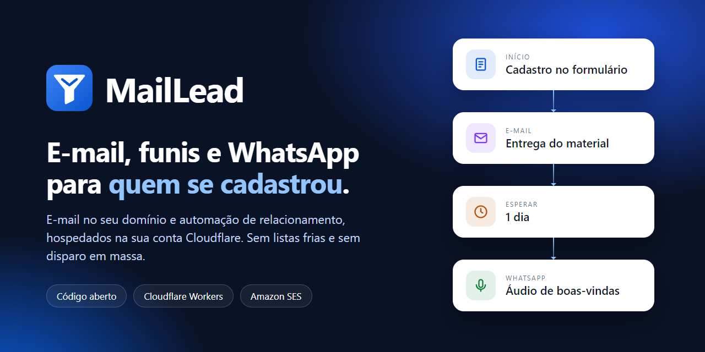

# MailLead

E-mail no seu domínio **e** automação de relacionamento, hospedados na sua própria conta Cloudflare.

O MailLead é um fork do [MailFlare](https://github.com/hieunc229/mailflare), com um aplicativo de **Marketing** construído por cima.

> **Regra do produto:** só fala com quem se cadastrou. Sem listas frias e sem disparo em massa de e-mail ou de WhatsApp.

## Marketing

| Área | O que faz |
| --- | --- |
| **Funis** | Fluxograma em tela cheia com caixas de e-mail, áudio no WhatsApp, espera (segundos a dias), condição, etiqueta e fim. Começa na entrada em uma lista ou ao receber uma etiqueta, com objetivo opcional. |
| **Teste do funil** | Você se cadastra como um lead e acompanha o que saiu. O teste fica aberto até você encerrar, e os números da tela se atualizam sozinhos. |
| **Modelos** | Editor por blocos e 22 e-mails prontos por uso (boas-vindas, conteúdo, eventos, vendas, clientes, reativação, avisos). A IA pode escolher o modelo. |
| **Campanhas** | Envio para listas de inscritos, com revisão antes, aberturas, cliques e limite por pessoa. |
| **Contatos e listas** | Registro de como cada pessoa aceitou, etiquetas, importação e exclusão a pedido. |
| **Captura** | Formulários com confirmação por e-mail, API com chaves próprias e webhook assinado. |
| **WhatsApp** | Mensagem de voz no funil pelo seu Evolution Go, só com aceite próprio, das 8h às 20h, com limite diário. Gravação pelo microfone. |
| **IA** | Chat que desenha o funil e escreve os e-mails com OpenAI, Anthropic ou Google, inclusive a partir de documentos anexados. A chave fica só no seu navegador. |
| **Envio** | Amazon SES, subdomínio separado, verificação de DNS, aquecimento, disjuntor por devoluções e reclamações, descadastro em um clique. |
| **Backup** | Cópia diária dos dados de marketing e restauração que não desfaz descadastros. |

O Marketing usa um banco próprio e só o administrador principal acessa.

Guias: [funis](docs/marketing/funis.md) · [modelos](docs/marketing/modelos.md) · [captura](docs/marketing/captura.md) · [envio](docs/marketing/envio.md) · [WhatsApp](docs/marketing/whatsapp.md) · [IA](docs/marketing/ia.md) · [backup](docs/marketing/backup.md)

### Ainda não tem

- Resposta "SAIR" automática no WhatsApp (hoje é o botão **Parar WhatsApp** no contato).
- Mensagem de texto no WhatsApp dentro do funil.
- Adaptadores para plataformas de venda (Hotmart, Kiwify e outras).
- Espera até uma data, testes A/B e pontuação de leads.

## E-mail e o restante

Herdado do MailFlare:

- **E-mail** no seu domínio, com caixas pessoais ou compartilhadas e regras de entrada. Envio e recebimento por Cloudflare Email, Resend ou Amazon SES.
- **Calendário, Agendamento e Drive.**
- **Agentes de IA** para o e-mail e acesso por MCP.
- **Admin:** usuários, 2FA, chaves de API, webhooks, auditoria e backups.

<table>
  <tr>
    <td align="center"><br>E-mail</td>
    <td align="center"><br>Calendário</td>
    <td align="center"><br>Drive</td>
  </tr>
</table>

## Instalar na Cloudflare

Precisa de uma conta Cloudflare com o domínio, Node.js e, para o marketing, uma conta Amazon SES.

```bash
git clone https://github.com/ricardosoli777/MailLead.git
cd MailLead
npm install
npx wrangler login
npx wrangler d1 create maillead-marketing
```

1. Em `wrangler.jsonc`, troque o `database_id` de `MARKETING_DB` pelo do banco que você criou. Crie também o D1 `mailflare`, o bucket R2 `mailflare-raw` e as filas `mailflare-inbound`, `mailflare-outbound` e `mailflare-agent`.
2. Mantenha o nome do Worker como `mailflare`.
3. Publique e prepare o banco de marketing:

```bash
npm run deploy
npx wrangler d1 migrations apply MARKETING_DB --remote
npx wrangler secret put CF_TOKEN
```

4. Abra `/setup`, crie o administrador, ative o 2FA ou uma chave de acesso e conecte o domínio.
5. Em **Marketing → Envio**, configure o remetente em um subdomínio só de marketing.

Permissões do `CF_TOKEN` e outras opções: [guia de publicação](docs/deployment.md).

## Atualizações

> **Não use o botão de atualizar do Admin nem o workflow `Dashboard Update`.** Eles trocam todo o código pelo do MailFlare original e removem o Marketing.

Para trazer correções do projeto de origem, faça o merge à mão e revise os conflitos:

```bash
git remote add upstream https://github.com/hieunc229/mailflare.git
git fetch upstream
git merge upstream/main
```

## Desenvolvimento local

```bash
cp .dev.vars.example .dev.vars
npm install
npm run db:migrate:local
npx wrangler d1 migrations apply MARKETING_DB --local
npm run dev
```

Testes do marketing: `node --test tests/marketing-*.test.mjs`

## Documentação do app

- [Publicação e configuração](docs/deployment.md)
- [Segurança](docs/security.md)
- [Bancos de dados](docs/databases.md)
- [Provedores de envio e recebimento](docs/providers.md)
- [API e integrações](docs/api.md)
- [Assistente de e-mail e MCP](docs/email-assistant-and-mcp.md)
- [Importar do Google Takeout](docs/import.md)
- [Solução de problemas](docs/troubleshooting.md)

## Créditos e licença

Baseado no [MailFlare](https://github.com/hieunc229/mailflare), de `hieunc229`. Distribuído sob a [GNU AGPL-3.0](LICENSE): quem usa uma versão modificada pela rede tem direito ao código-fonte dela.
